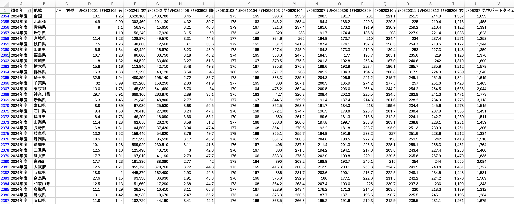
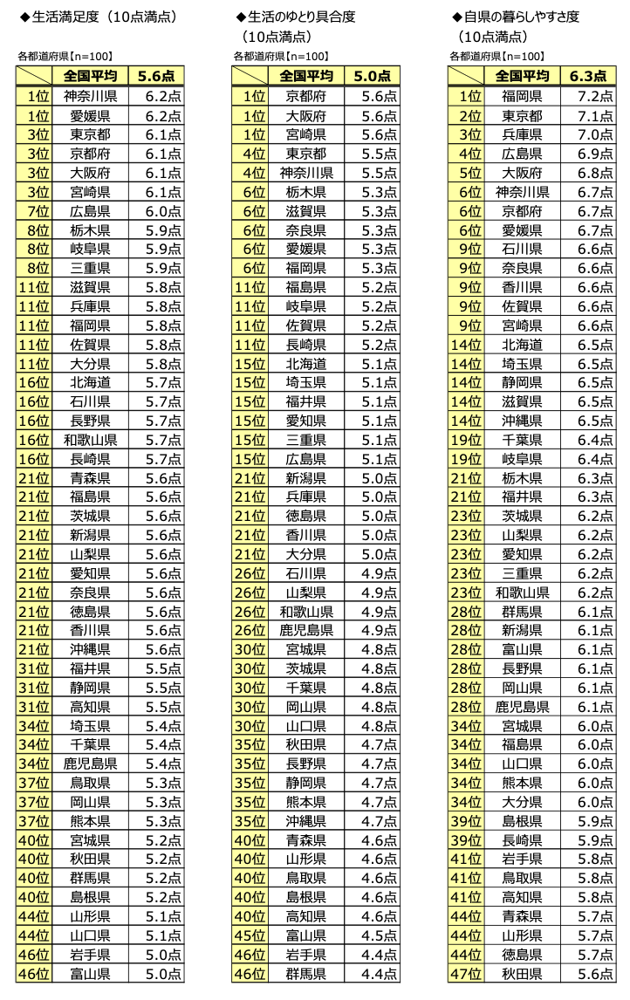
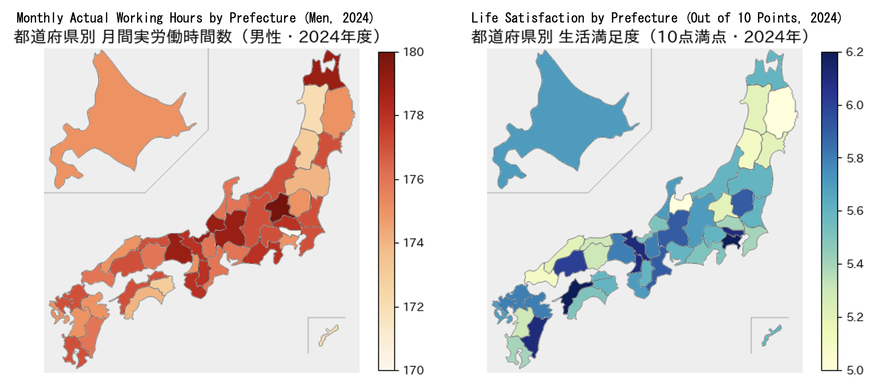
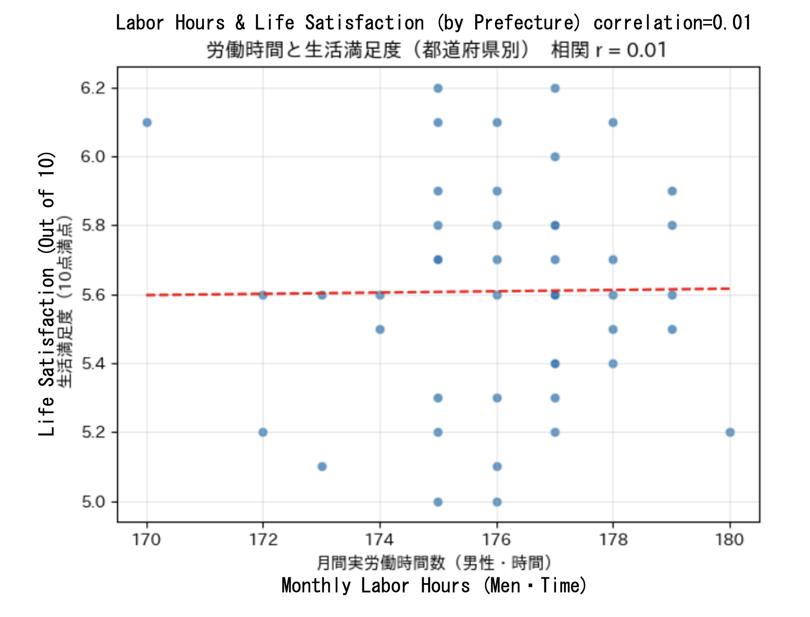

# Project: A Global & Regional Data Analysis on Work Hours, Mental Health & Life Satisfaction

`japan_prefecture_maps.ipynb`: Scripts used for Visualization of Working Hours × Life Satisfaction by Prefecture

`labour-happiness-analysis-en.pdf`: Slide presentation summarizing the data analysis, domestic/international findings, Python visualization methodologies, and workplace policy recommendations (ENG version)

`labour-happiness-analysis-jp.pdf`: Slide presentation summarizing the data analysis, domestic/international findings, Python visualization methodologies, and workplace policy recommendations (JPN version)

## Problem

> Main purpose of this analysis is to **find the relationship between working hours, life satisfaction and mental health.**

The motivation behind this project stems from my own experience as an international student living in Japan. While Japan is widely recognized for its safety and high standard of living, challenges surrounding its demanding workplace culture remain a persistent concern. Long working hours and high-pressure environments continue to impact employee well-being, with suicide remaining a critical issue among younger demographics. This project investigates the empirical relationship between working hours, mental health claims, and overall life satisfaction on both a domestic and global scale.

###### *Note: This analysis was originally conducted as a semester final project for Media Communication Advanced Lecture & Seminar B (May-July 2026). The original findings and visual slide deck were translated from Japanese to English for inclusion in this data analytics portfolio.*

## Dataset

Data was gathered from multiple public statistics and survey reports:

- **Ministry of Health, Labour and Welfare (MHLW):**
    - "Survey on Industrial Health" (平成24年労働者健康状況調査): https://www.mhlw.go.jp/toukei/list/h24-46-50.html
    - "Physician Interview Guidance System for Long-Hour Workers" (長時間労働者への医師による面接指導制度について): https://www.mhlw.go.jp/bunya/roudoukijun/anzeneisei12/pdf/08.pdf
    - "Workers' Compensation Status for Brain/Heart Diseases and Mental Disorders" (平成24年度脳・心臓疾患と精神障害の労災補償状況まとめ): https://www.mhlw.go.jp/stf/houdou/2r98520000034xn0.html
- **Ministry of Internal Affairs and Communications (MIC)/e-Stat:**
    - "System of Social and Demographic Statistics" (社会・人口統計体系「社会生活統計指標」): https://www.e-stat.go.jp/dbview?sid=0000010206
- **OECD Data Explorer:**
    - "Average Annual Hours Actually Worked Per Worker": https://www.oecd.org/en/data/indicators/hours-worked.html
- **World Happiness Report 2025:**
    - Global country rankings for life satisfaction scores (2022-2024 data): https://data.worldhappiness.report/table
- **Sony Life Insurance Co., Ltd:**
    - "47-Prefecture Life Awareness Survey 2024" (47都道府県別　生活意識調査2024): https://www.sonylife.co.jp/company/news/2024/nr_241212.html

## Tools:

`Microsoft Excel` `Google Colab` `Python`

**Data Prep & Processing:**
- Microsoft Excel (organizing, structuring raw dataset rows, and extracting tabular data from PDF survey reports)

**Development Environment:**
- Google Colab (cloud Python environment)

**Data Analysis & Visualization (Python Libraries):**
- `numpy`: Correlation coefficient calculations (`np.corrcoef`) and polynomial regression fitting (`np.polyfit`)
- `matplotlib`: Custom scatter plot generation, axis labeling, figure styling, and color-mapping (`Normalize`, `cm.ScalerMappable`)
- `japanmap`: Geospatial visualization of Japan's 47 prefectures mapped to color gradients
- `japanize_matplotlib`: Enabling Japanese text rendering within Matplotlib figures

## Methodology:

1. **Data Aggregation & Preparation:**
    - Extracted government data on overtime, mental health claims, and regional working hours from e-Stat and MHLW releases.
    
    - Consolidated global work hours (OECD) and happiness scores (World Happiness Report) into structured data tables.
    - Extracted prefectural life satisfaction metrics from Sony Life's survey PDF into Excel.
    
    

2. **Geospatial Heatmap Mapping:**
    - Built a custom Python rendering function (`draw_map`) utilizing `japanmap` and `matplotlib.colors.Normalize` to dynamically color-code Japanese prefectures according to monthly working hours and life satisfaction scores.
    

3. **Statistical Correlation Analysis:**
    - Calculated Pearson's correlation coefficient (r = 0.01) in Python using `np.corrcoef` to measure the linear relationship between prefectural male working hours and life satisfaction.
    - Plotted scatter plots with linear regression trendlines (`np.polyfit`) to visualize domestic data distribution.
    
    - Compared international cross-country trends between annual hours worked and global happiness rankings.

## Insights:

**International Inverse Correlation:**
- Globally, countries with shorter average working hours (e.g., Finland at 1,509 hrs/year, score: 7.74) generally exhibit significantly higher life satisfaction scores than countries with excessive working hours (e.g., Mexico at 2,193 hrs/year, score: 6.98).

**Japan's Statistical Distortion:**
- Japan's official annual working hours (1,617 hrs) appear moderately low globally due to a high proportion of non-regular/part-time workers (~40%) skewing the average down. Despite this, Japan's life satisfaction (6.15) remains among the lowest in developed OECD economies.

**Lack of Direct Domestic Correlation (r = 0.01):**
- Within Japan, prefectural working hours show virtually no linear correlation with local life satisfaction. Regional happiness is governed more heavily by income, social infrastructure, and broader living conditions rather than work hours alone.

**Rising Mental Health Distress:**
- Compensation claims for work-related mental disorders rose steadily from 927 in 2008 to 1,257 in 2012. Working beyond the "Karoshi line" (80-100 hours of monthly overtime) severely increases risks of depression, cardiovascular issues, and fatigue accumulation.

## Recommendations:

**Enforce Strict Caps Below the Karoshi Threshold:**
- Organizations must implement hard caps on monthly overtime to prevent workers from reaching 80-100 overtime hours per month, as health risks increase exponentially past this limit.

**Promote Proactive Medical Consultations:**
- Address the high awareness gap regarding health intervention systems (approx. 40% of establishments were unaware of physician guidance programs) by mandating employer-led consultations for long-hour workers rather than waiting for voluntary employee requests.

**Implement Workplace Mental Health Support:**
- Expand corporate mental health programs beyond basic training. Employers should set up internal mental health consultation desks, adjust night-shift frequencies, and allow job reassignments to protect long-term employee well-being and productivity.
